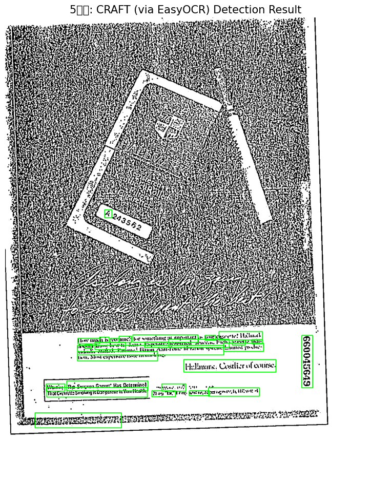
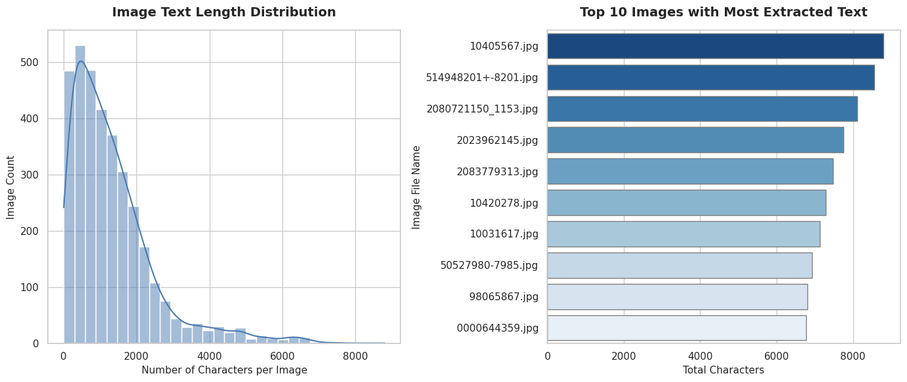
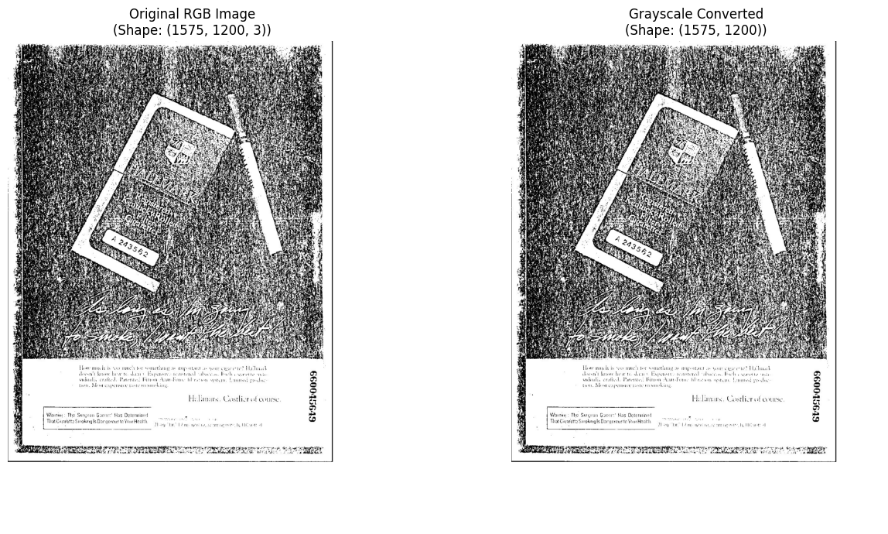
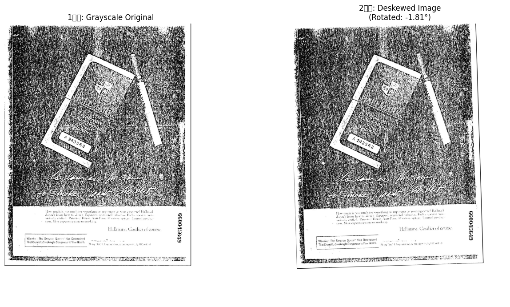
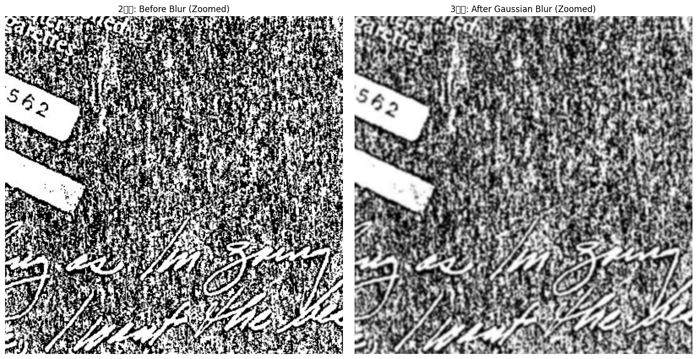
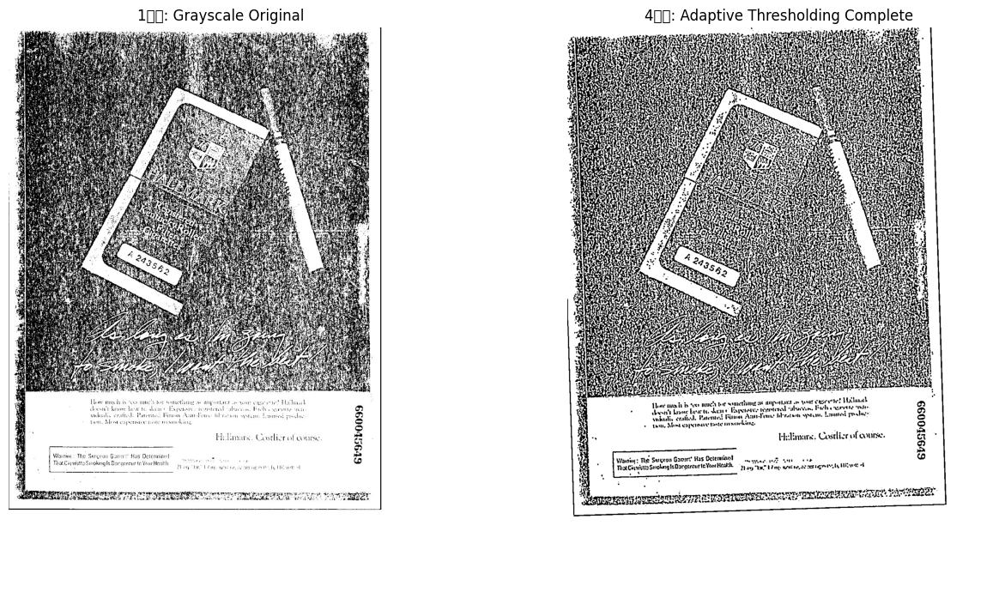
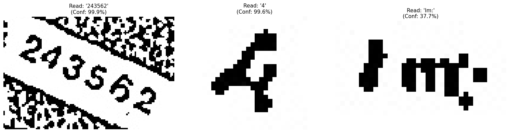

# EasyOCR 기반 영문 문서 OCR 파이프라인

> 광고·편지·신문·논문 등 10종의 노이즈 많은 영문 스캔 문서 **3,482장(Tobacco3482)**을 OpenCV 전처리 4단계 + EasyOCR(CRAFT · CRNN)로 일괄 텍스트화

[](https://colab.research.google.com/github/pshcom/easyocr-document-ocr-pipeline/blob/main/OCR.ipynb)


| 기간 | 인원 | 환경 |
| --- | --- | --- |
| 2026.03 ~ 2026.06 | 1명 (개인) | Google Colab (GPU) |

<p align="center"></p>

## 목차
1. [프로젝트 목적](#1-프로젝트-목적)
2. [주요 결과](#2-주요-결과)
3. [파이프라인](#3-파이프라인)
4. [전처리 단계별 설계](#4-전처리-단계별-설계)
5. [텍스트 탐지 · 인식 (EasyOCR)](#5-텍스트-탐지--인식-easyocr)
6. [실행 방법](#6-실행-방법)
7. [트러블슈팅](#7-트러블슈팅)
8. [한계 및 개선 계획](#8-한계-및-개선-계획)

---

## 1. 프로젝트 목적
오래된 스캔 문서는 종이 황변, 불균일한 조명, 인쇄 망점, 미세한 기울어짐 때문에 OCR 엔진에 그대로 넣으면 인식이 불안정합니다. 이 프로젝트는 **전처리로 입력 품질을 정리한 뒤 EasyOCR로 대량 문서를 일괄 텍스트화**하는 파이프라인을 만들고, 추출 결과를 통계로 분석합니다.

**데이터셋: Tobacco3482**
담배 관련 소송 과정에서 공개된 문서를 스캔한 공개 데이터셋으로, 3,482장이 10개 클래스로 나뉘어 있습니다.
`ADVE` · `Email` · `Form` · `Letter` · `Memo` · `News` · `Note` · `Report` · `Resume` · `Scientific`

## 2. 주요 결과

| 지표 | 결과 |
| --- | --- |
| 처리한 문서 이미지 | 3,482장 (10종) |
| 총 추출 글자 수 | 4,661,817자 |
| 이미지당 평균 추출 분량 | 1,338.8자 |
| 이미지 1장 최대 추출 | 8,803자 |

<p align="center"><br><sub>이미지별 추출 글자 수 분포(좌) / 추출량 상위 10개 이미지(우)</sub></p>

대부분 2,000자 이하에 몰린 오른쪽 꼬리 분포이며, 상위 10개 이미지는 모두 약 7,000자 이상의 장문 문서였습니다.

## 3. 파이프라인

```
원본 스캔 이미지
  → ① Grayscale 변환
  → ② 미세 기울기 보정 (Canny + Probabilistic Hough)
  → ③ 가우시안 블러 (5×5)
  → ④ 적응형 이진화 (Gaussian, blockSize 11, C 2)
  → ⑤ CRAFT 텍스트 영역 탐지
  → ⑥ CRNN 문자열 인식
  → ocr_final_results.txt  ([파일 경로] 추출 텍스트)
  → 통계 분석 · 시각화
```

## 4. 전처리 단계별 설계

| 단계 | 처리 | 이유 |
| --- | --- | --- |
| ① Grayscale | BGR 3채널 → 1채널 | 색 정보는 문자 인식에 불필요. 연산량을 1/3로 줄여 3,482장 배치 처리 시 메모리 부담 감소 |
| ② 기울기 보정 | Canny 에지 → HoughLinesP → ±45° 이내 직선 각도의 **중앙값**으로 Affine 회전, 빈 영역은 흰색(255) | 스캔 중 생긴 미세 회전으로 텍스트 줄이 꼬이는 것을 방지. 중앙값은 일부 오검출 직선에 강인 |
| ③ 가우시안 블러 | 5×5 커널 | 스캔 입자와 인쇄 망점을 평활화해 노이즈가 글자 획으로 오인식되는 것을 방지 |
| ④ 적응형 이진화 | `ADAPTIVE_THRESH_GAUSSIAN_C`, blockSize 11, C 2 | 황변·음영처럼 영역마다 밝기가 다른 문서에서 전역 임계값을 쓰면 어두운 구석의 글자가 사라짐 → 영역별 임계값 사용 |

| ① Grayscale | ② 기울기 보정 (예: −1.81°) |
| --- | --- |
|  |  |
| **③ 가우시안 블러 (확대)** | **④ 적응형 이진화** |
|  |  |

## 5. 텍스트 탐지 · 인식 (EasyOCR)

EasyOCR은 **CRAFT(탐지) + CRNN(인식)** 2단계 구조입니다.

- **CRAFT**: 글자의 중심(Region score)과 글자 사이 연결(Affinity score)을 픽셀 단위 확률맵으로 예측해 단어 박스를 만듭니다. 줄 단위가 아니라 글자 연결 관계로 단어를 묶기 때문에, 다단 문서에서도 단을 넘어 글이 이어 붙지 않습니다.
- **CRNN**: CNN으로 시각 특징을 뽑고, RNN이 왼쪽부터 순서대로 읽으며 앞뒤 문맥을 반영합니다(예: `l` / `1` / `I` 구분). CTC가 중복 출력(`a-a-p-p-l-e`)을 정리해 최종 단어로 만듭니다.

```python
reader = easyocr.Reader(['en'], gpu=True)
horizontal_boxes, _ = reader.detect(img_path)   # ⑤ CRAFT 탐지만
results = reader.readtext(img_path)              # ⑤ + ⑥ 탐지와 인식을 한 번에 → (bbox, text, confidence)
```

<p align="center"><br><sub>신뢰도 상위 단어 예시</sub></p>

## 6. 실행 방법

Colab에서 실행합니다. 위의 **Open in Colab** 버튼으로 노트북을 바로 열 수 있습니다.

1. Tobacco3482 데이터셋을 `dataset/클래스명/*.jpg` 구조로 압축해 Google Drive에 `dataset.zip`으로 올립니다. (데이터셋은 용량 문제로 저장소에 포함하지 않았습니다.)
2. 런타임 유형을 **GPU**로 설정합니다.
3. 셀을 위에서부터 순서대로 실행합니다.

| 셀 구간 | 내용 | 출력 |
| --- | --- | --- |
| 데이터셋 준비 | Drive 마운트, `dataset.zip` 압축 해제 | `/content/workspace/dataset` |
| 전처리 1~4단계 | 이미지 1장으로 단계별 결과 시각화 | 비교 그림 |
| 전체 전처리 | 3,482장 일괄 전처리 | `/content/workspace/preprocessed_dataset` |
| CRAFT · CRNN | 1장으로 탐지·인식 결과 확인 | 박스 그림, 단어별 신뢰도 |
| 최종 추출 | 전체 이미지 텍스트 추출 | `ocr_final_results.txt` |
| 결과 분석 | 글자 수 통계, 분포 그래프 | 통계, 그래프 |

### 폴더 구조
```
├── OCR.ipynb        # 전체 파이프라인 (Colab)
└── docs/images/     # README 이미지 (노트북 출력)
```

## 7. 트러블슈팅

### ① 다단 구성 문서에서 좌우 단의 글이 한 줄로 섞임
- **문제**: 신문·논문처럼 세로로 여러 단이 나뉜 문서는 줄 단위로 읽으면 왼쪽 단과 오른쪽 단의 문장이 가로로 이어 붙습니다.
- **원인**: 단어 사이 공백과 단 사이 간격을 구분하지 못하고 같은 높이의 글자를 한 줄로 묶기 때문입니다.
- **해결**: 글자 중심과 글자 간 연결을 확률맵으로 예측하는 CRAFT 탐지기를 사용해, 단어 단위로 영역을 잡아 단이 섞이지 않게 했습니다.

### ② 잉크 망점 · 거친 입자가 글자로 오인식됨
- **문제**: 스캔 문서의 망점과 입자가 글자 주변 잔상으로 남아 OCR 엔진이 글자의 일부로 인식했습니다.
- **해결**: 이진화 전에 가우시안 블러로 평활화해 자잘한 잔상을 걸러낸 뒤 적응형 이진화를 적용했습니다.

## 8. 한계 및 개선 계획
- **정확도 정량 평가 부재**: 지금은 추출 분량으로만 결과를 확인했습니다. 정답 텍스트 일부를 만들어 문자 오류율(CER)을 측정할 계획입니다.
- **전처리 효과 검증**: 단어별 인식 신뢰도가 낮게 나오는 이미지가 있어, 원본과 전처리 입력의 인식 결과를 비교해 이진화가 오히려 노이즈를 키우는 경우를 확인할 계획입니다.
- **경로 정리**: 최종 결과는 `/content/workspace/`에 저장되고 분석 셀은 `/content/`에서 읽도록 되어 있어, 경로를 하나로 통일할 예정입니다.
- 문서 종류(10개 클래스)별 추출량 · 신뢰도 비교 분석
